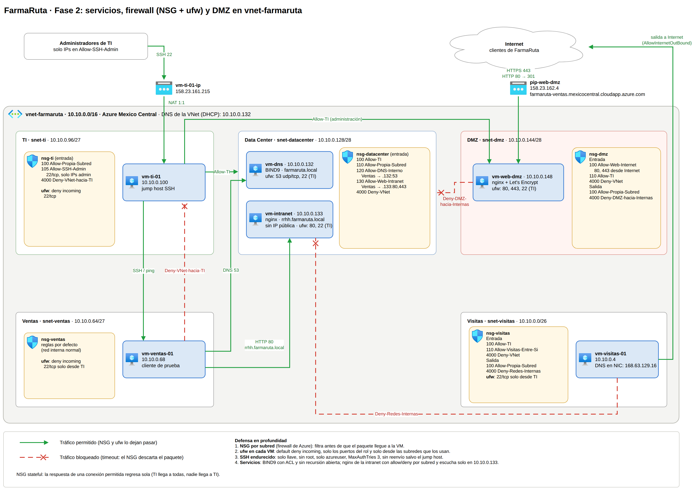

# FarmaRuta en Azure

**Proyecto Final · CC3067 Redes · Universidad del Valle de Guatemala**


FarmaRuta es una startup guatemalteca que compara en tiempo real los precios de medicamentos entre farmacias. En este proyecto se diseñó, desplegó y aseguró su red empresarial en **Microsoft Azure** usando solo el crédito de Azure for Students.

| Fase | Contenido | Entregable |
|---|---|---|
| **Fase 1** | VNet segmentada con VLSM, una subred por área, NSG y prueba de conectividad | [PDF](Proyecto_Final_Fase_1_Redes.pdf) · [Word](<Proyecto Final Fase 1 — FarmaRuta en Azure.docx>) |
| **Fase 2** | DNS interno, intranet de RRHH, firewall y ACLs, hardening y DMZ con web pública HTTPS | [PDF](Informe_Proyecto_Final_Fase2_FarmaRuta.pdf) · [Word](Informe_Proyecto_Final_Fase2_FarmaRuta.docx) |

---

## Arquitectura



Una sola VNet `10.10.0.0/16` en Mexico Central, segmentada con VLSM sobre `10.10.0.0/24`. Cada subred tiene su propio Network Security Group.

| Subred | Rango | Usables en Azure | Servidores / VMs |
|---|---|---|---|
| Visitas | `10.10.0.0/26` | 59 | `vm-visitas-01` · 10.10.0.4 |
| Ventas | `10.10.0.64/27` | 27 | `vm-ventas-01` · 10.10.0.68 |
| TI | `10.10.0.96/27` | 27 | `vm-ti-01` · 10.10.0.100 (jump host) |
| Data Center | `10.10.0.128/28` | 11 | `vm-dns` · 10.10.0.132 · `vm-intranet` · 10.10.0.133 |
| DMZ | `10.10.0.144/28` | 11 | `vm-web-dmz` · 10.10.0.148 |

> Azure reserva 5 direcciones por subred, por eso cada bloque se dimensiona con `2^(32-n) - 5 ≥ hosts`.

## Servicios

| Servicio | Dónde | Detalle |
|---|---|---|
| **DNS interno** | `vm-dns` | BIND9 autoritativo para `farmaruta.local` y su zona inversa, con forwarder al DNS de Azure y ACL solo para redes internas |
| **Intranet de RRHH** | `vm-intranet` | nginx en `http://rrhh.farmaruta.local`, sin IP pública, solo para Ventas, TI y Data Center |
| **Web pública** | `vm-web-dmz` | nginx en `https://farmaruta-ventas.mexicocentral.cloudapp.azure.com`, con certificado Let's Encrypt y redirección 301 a HTTPS |
| **Administración** | `vm-ti-01` | Jump host SSH: único punto de entrada, solo desde las IP del equipo |

## Seguridad

La seguridad se aplica en varias capas independientes (defensa en profundidad):

1. **NSG por subred**: firewall stateful de Azure, sin costo, en lugar de Azure Firewall.
2. **ufw en cada VM**: `default deny incoming` y solo los puertos del rol.
3. **SSH endurecido**: solo llave pública, sin root, `MaxAuthTries 3` y reenvío solo en el jump host.
4. **Servicios**: BIND sin recursión abierta y nginx con `allow`/`deny` por subred.

Matriz de conectividad comprobada con las seis VMs encendidas:

| Desde \ Hacia | TI | Ventas | DNS :53 | Intranet :80 | DMZ (privada) | Internet |
|---|:-:|:-:|:-:|:-:|:-:|:-:|
| **Visitas** | ❌ | ❌ | ❌ | ❌ | ❌ | ✅ |
| **Ventas** | ❌ | — | ✅ | ✅ | ❌ | ✅ |
| **TI** | — | ✅ | ✅ | ✅ | ✅ | ✅ |
| **DMZ** | ❌ | ❌ | ❌ | ❌ | — | ✅ |

## Estructura del repositorio

```
ProyectoFinal-Redes/
├── Informe_Proyecto_Final_Fase2_FarmaRuta.pdf   Informe final (Fase 2)
├── Proyecto_Final_Fase_1_Redes.pdf              Informe de la Fase 1
├── config/
│   ├── farmaruta_fase1.sh                       Despliegue de la Fase 1 (Azure CLI)
│   └── fase2/
│       ├── 00_variables.sh … 04_pruebas_firewall.sh   Red, NSG, VMs y pruebas
│       ├── 05_dns.sh          dns/        BIND9: opciones y zonas
│       ├── 06_intranet.sh     intranet/   nginx de RRHH y página
│       ├── 07_web_dmz.sh      dmz/        Web pública y HTTPS
│       ├── 08_hardening.sh    hardening/  ufw, SSH y salidas antes/después
│       ├── pruebas/                       nmap, matrices y validación final
│       ├── diagrama/                      Diagrama .drawio y .png
│       └── limpiar_fase2.sh               Borra todo al terminar
├── capturas/fase2/                       Evidencias del portal y de las pruebas
└── docs/fase2/                           Detalle técnico de cada servicio
```

## Cómo reproducirlo

Desde Azure Cloud Shell (Bash), en orden:

```bash
cd config/fase2
bash 01_red_base.sh                          # resource group, NSG, VNet y subredes
ADMIN_IPS="tu.ip.publica" bash 02_firewall_nsg.sh   # reglas de firewall + SSH de administración
bash 03_vms.sh                               # máquinas virtuales
bash 05_dns.sh && bash 06_intranet.sh        # DNS interno e intranet
bash 07_web_dmz.sh ruta/a/farmaruta-key.pem  # web pública (desde la compu del admin)
bash 08_hardening.sh                         # hardening en todas las VMs
bash 04_pruebas_firewall.sh                  # matriz de pruebas
```

Para administrar un servidor interno se salta por el jump host:

```bash
ssh -i farmaruta-key.pem -J azureuser@<IP_PUBLICA_TI> azureuser@10.10.0.133
```

> La llave privada nunca se sube al repositorio (`*.pem` está en `.gitignore`).
> Al terminar, `bash limpiar_fase2.sh` borra el resource group para que no siga cobrando.

## Equipo

| Integrante | Carné | Aporte en la Fase 2 |
|---|---|---|
| Nicolás Concuá | 23197 | Red base, subred DMZ, NSG (firewall y ACLs), jump host e integración del informe |
| Daniela Ramírez | 23053 | DNS interno con BIND9 |
| Andrés Mazariegos | 21749 | Intranet de RRHH con nginx |
| June Herrera | 231038 | Web pública en la DMZ con HTTPS |
| Fernando Mendoza | 19644 | Hardening, pruebas de bloqueo, diagrama y validación final |

---

<sub>CC3067 Redes · Universidad del Valle de Guatemala · Noviembre de 2026</sub>
