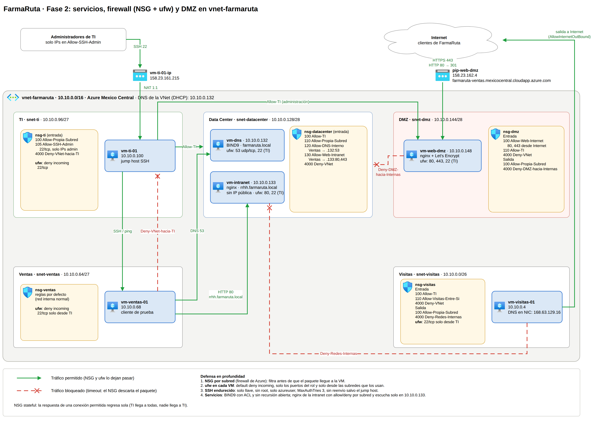

# Seguridad y validación: hardening, pruebas de bloqueo y diagrama (Fernando)

> Sección para el reporte de la Fase 2. Pasar a Word junto con las capturas de `capturas/fase2/seguridad/` y el diagrama de `config/fase2/diagrama/`.

## Qué se implementó

1. **Hardening** de todas las VMs (5 aplicadas; vm-dns queda lista en el script para cuando exista): firewall del host con **ufw** (default deny), SSH endurecido y servicios innecesarios apagados.
2. **Pruebas de bloqueo** entre subredes y desde internet (matriz "quién llega a quién"), con `ping`, `nc`, `curl` y `nmap`.
3. **Diagrama de red actualizado** con la DMZ, los NSG, el DNS, los dos servidores web y los flujos permitidos y bloqueados.
4. VMs de prueba **vm-ventas-01** (10.10.0.68) y **vm-visitas-01** (10.10.0.4), sin IP pública, para las pruebas desde cada subred.

Todo se hizo por SSH saltando por el jump host de TI:

```bash
ssh -i farmaruta-key.pem -J azureuser@158.23.161.215 azureuser@10.10.0.133
```

## Diagrama de red



`config/fase2/diagrama/diagrama_red_fase2.drawio` (editable en draw.io) y `diagrama_red_fase2.png`. Parte del diagrama de la Fase 1 y agrega:

- La subred **DMZ** `10.10.0.144/28` con `vm-web-dmz` y su IP pública `pip-web-dmz` (`farmaruta-ventas.mexicocentral.cloudapp.azure.com`).
- La IP pública del jump host `vm-ti-01` (SSH solo desde las IPs de los administradores).
- En el Data Center, `vm-dns` (10.10.0.132, BIND9) y `vm-intranet` (10.10.0.133, `rrhh.farmaruta.local`).
- Un escudo por subred con el NSG y sus reglas, y las reglas de ufw de cada VM.
- Flechas verdes para el tráfico permitido y rojas punteadas para el bloqueado, con el nombre de la regla que lo decide.

## Parte 1: Hardening

### Por qué ufw si ya existen los NSG

Es **defensa en profundidad**. El NSG filtra en la red de Azure, antes de que el paquete llegue a la VM; ufw (iptables/nftables por debajo) filtra dentro del sistema operativo. Si alguien cambia mal un NSG, la VM sigue protegida, y si alguien levanta un servicio nuevo en la VM por error, el NSG sigue filtrando. Además, ufw es más estricto que el NSG en un punto: el NSG deja a TI llegar a **todo** el Data Center (`Allow-TI`), pero ufw solo deja pasar los puertos del servicio.

### Metodología

Por cada VM: `ss -tulpn` antes, aplicar `hardening.sh`, y `ss -tulpn` + `ufw status numbered` después. Antes de activar ufw siempre se agrega la regla de SSH, para no perder el acceso. Se empezó por `vm-ventas-01` (de prueba), luego las de servicio y al final el jump host, verificando después de cada una que el servicio y el salto SSH siguieran funcionando.

### Reglas de ufw por VM

Todas: `default deny incoming`, `default allow outgoing`, `logging low`.

| VM | Rol | Entrada permitida | Por qué |
|---|---|---|---|
| vm-ti-01 | Jump host | 22/tcp | Es la entrada de los administradores. El origen ya lo limita el NSG (`Allow-SSH-Admin`) |
| vm-dns | DNS | 22/tcp desde TI · 53 udp/tcp desde Ventas, TI y Data Center | Solo las redes que usan el DNS interno. Visitas y DMZ usan el DNS de Azure. Se aplica con `bash 08_hardening.sh aplicar vm-dns` cuando la VM exista |
| vm-intranet | Intranet | 22/tcp desde TI · 80/tcp desde Ventas, TI y Data Center | Igual a la ACL de nginx (`allow`/`deny`) y al NSG |
| vm-web-dmz | Web pública | 22/tcp desde TI · 80/tcp y 443/tcp desde cualquiera | 443 es el sitio. 80 redirige a HTTPS (301) y lo usa Let's Encrypt para renovar el certificado (reto HTTP-01) |
| vm-ventas-01 · vm-visitas-01 | Clientes | 22/tcp desde TI | No ofrecen ningún servicio |

Cada regla lleva un comentario (`ufw ... comment '...'`), así se lee en el `ufw status numbered` para qué es.

### SSH

Archivo `/etc/ssh/sshd_config.d/10-farmaruta-hardening.conf` (copia en `config/fase2/hardening/sshd_hardening.conf`). Va con prefijo `10-` porque sshd se queda con el **primer** valor que lee, y la imagen de Azure trae su propio `50-cloudimg-settings.conf`.

| Directiva | Valor | Antes | Por qué |
|---|---|---|---|
| `PermitRootLogin` | `no` | `without-password` | Nadie entra como root; se entra como `azureuser` y se usa `sudo` |
| `PasswordAuthentication` / `KbdInteractiveAuthentication` | `no` | `no` | Solo llave pública. Sin contraseñas no hay fuerza bruta posible |
| `AllowUsers` | `azureuser` | (todos) | Único usuario autorizado |
| `MaxAuthTries` | `3` | `6` | Menos intentos por conexión |
| `LoginGraceTime` | `30` | `120` | Menos tiempo para autenticarse |
| `X11Forwarding` | `no` | `yes` | Son servidores sin entorno gráfico |
| `AllowAgentForwarding` | `no` | `yes` | No se reenvía la llave del administrador a los servidores |
| `AllowTcpForwarding` | `no` (`yes` solo en vm-ti-01) | `yes` | `ssh -J` necesita reenvío TCP en el jump host; en las demás no hace falta |
| `ClientAliveInterval` / `CountMax` | `300` / `2` | `0` | Cierra sesiones colgadas después de unos 10 minutos |

Antes de reiniciar se valida con `sshd -t`; si la configuración tiene un error, el script se detiene y SSH sigue como estaba.

### Servicios

`systemctl list-units --type=service --state=running` mostraba servicios que no tienen sentido en un servidor de Azure. Se deshabilitaron con `systemctl disable --now`:

| Servicio | Para qué sirve | Por qué se apaga |
|---|---|---|
| `ModemManager` | Módems 3G/4G | Una VM no tiene módem |
| `udisks2` | Montar USB y discos desde el escritorio | No hay escritorio ni USB |
| `fwupd` y `fwupd-refresh.timer` | Firmware de hardware físico | El hardware lo administra Azure |
| `multipathd` y su socket | Discos SAN con varias rutas | Los discos administrados no usan multipath |

Se dejaron `ssh`, `chrony` (hora), `systemd-resolved` (DNS local, solo en 127.0.0.53), `walinuxagent` (agente de Azure, necesario para `run-command` y el aprovisionamiento), `unattended-upgrades` (parches de seguridad) y el servicio de cada rol.

### Antes y después

En las 5 VMs ufw estaba **inactivo** y el único servicio expuesto fuera de loopback era el del rol (22, 53, 80 o 443). Después del hardening ufw está activo con *default deny* y cada puerto solo acepta las subredes que lo usan. `ss -tulpn` sigue mostrando los mismos puertos en escucha: ufw no apaga los servicios, decide **quién** puede llegar a ellos.

| VM | Puertos en escucha (fuera de loopback) | ufw antes | ufw después |
|---|---|---|---|
| vm-ti-01 | 22 | inactive | 22 |
| vm-intranet | 22, 80 (solo 10.10.0.133) | inactive | 22 desde TI; 80 desde Ventas, TI y DC |
| vm-web-dmz | 22, 80, 443 | inactive | 22 desde TI; 80 y 443 desde cualquiera |
| vm-ventas-01 | 22 | inactive | 22 desde TI |
| vm-visitas-01 | 22 | inactive | 22 desde TI |

Las salidas completas están en `config/fase2/hardening/<vm>/` (`01_antes.txt`, `02_aplicacion.txt`, `03_despues.txt`).

### Prueba de defensa en profundidad

Para comprobar que ufw agrega protección real, se levantó un servicio de prueba en `vm-intranet` en el puerto 8080 (`python3 -m http.server 8080`). El NSG **sí** deja pasar a TI (`Allow-TI` permite todos los puertos), pero desde `vm-ti-01` la conexión da *timeout* y el kernel de vm-intranet registra el bloqueo:

```
[UFW BLOCK] IN=eth0 ... SRC=10.10.0.100 DST=10.10.0.133 ... PROTO=TCP ... DPT=8080 ... SYN
```

Es decir, un servicio que alguien deje abierto por error no queda expuesto. Al terminar la prueba se apagó el servicio. Captura `21_ufw_bloquea_puerto_no_autorizado.png`.

## Parte 2: Pruebas de bloqueo

### nmap desde TI

TI es la única subred que el NSG deja llegar a todos los puertos, así que desde `vm-ti-01` se ve exactamente lo que deja pasar ufw. Escaneo de los 65 535 puertos TCP:

```bash
sudo nmap -Pn -sS -p- --min-rate 2000 10.10.0.4 10.10.0.68 10.10.0.133 10.10.0.148
```

| Host | open | El resto |
|---|---|---|
| vm-visitas-01 (10.10.0.4) | 22 | 65 534 *filtered* |
| vm-ventas-01 (10.10.0.68) | 22 | 65 534 *filtered* |
| vm-intranet (10.10.0.133) | 22, 80 | 65 533 *filtered* |
| vm-web-dmz (10.10.0.148) | 22, 80, 443 | 65 532 *filtered* |

*open*: hay un servicio y el firewall lo permite. *filtered*: el firewall descartó el paquete y no hubo respuesta. No aparece ningún *closed*, porque con *default deny* el paquete se descarta antes de llegar al sistema. Así un atacante no puede saber si hay algo detrás de un puerto.

### Matriz de conectividad

Con las 5 VMs encendidas al mismo tiempo. TCP con `nc -zv -w 3 IP PUERTO` (*succeeded* o *timed out*), ICMP con `ping -c 2 -W 2` e internet con `curl -sI https://www.google.com`.

| Desde \ Hacia | TI (ping / 22) | Ventas (ping) | DNS :53 | Intranet :80 | DMZ :80/443 (IP privada) | Internet |
|---|---|---|---|---|---|---|
| **Visitas** (10.10.0.4) | ❌ / ❌ | ❌ | ⏳ ¹ | ❌ | ❌ / ❌ | ✅ |
| **Ventas** (10.10.0.68) | ❌ / ❌ | — | ⏳ ¹ | ✅ | ❌ | ✅ |
| **TI** (10.10.0.100) | — | ✅ | ⏳ ¹ | ✅ | ✅ / ✅ | ✅ |
| **DMZ** (10.10.0.148) | ❌ | ❌ | ⏳ ¹ | ❌ | — | ✅ |

Coincide con el comportamiento que pide el enunciado:

- **Visitas** sale a internet pero no llega a ninguna red interna (`nsg-visitas` → `Deny-Redes-Internas`, salida, 4000).
- **TI** llega a todas las subredes; ninguna llega a TI (`nsg-ti` → `Deny-VNet-hacia-TI`, 4000). TI también llega a vm-visitas-01 (ping y 22).
- La **intranet** responde a Ventas y TI, no a Visitas ni a la DMZ (`nsg-datacenter` → `Allow-Web-Intranet` 130 y `Deny-VNet` 4000), y no existe desde internet porque no tiene IP pública.
- La **DMZ** no inicia conexiones hacia la red interna (`nsg-dmz` → `Deny-DMZ-hacia-Internas`, salida, 4000).

¹ Pendiente de `vm-dns` (Daniela). Se corre con los mismos comandos cuando la VM exista: `nc -zv -w 3 10.10.0.132 53` y `nslookup rrhh.farmaruta.local 10.10.0.132`. Esperado: ✅ desde Ventas y TI, ❌ (timeout) desde Visitas y DMZ.

También se probó el sentido contrario hacia Visitas: TI llega (ping y 22), la DMZ no (su NSG le niega la salida) y Ventas sí llega con ping. Eso último no lo cubre la tabla del enunciado y se explica en *Hallazgo: tráfico interno hacia Visitas*.

**¿Por qué TI llega a Ventas, pero Ventas no llega a TI?** Los NSG son **stateful**: cuando TI inicia la conexión, el NSG de TI deja pasar la respuesta aunque `Deny-VNet-hacia-TI` bloquee lo que **entra** desde la VNet. Cuando la conexión la inicia Ventas, el paquete es nuevo y se descarta.

**Ventas → DMZ por IP privada falla, pero la web pública sí carga.** Desde Visitas o Ventas, `https://farmaruta-ventas.mexicocentral.cloudapp.azure.com` responde 200, porque el tráfico sale a internet y entra por la IP pública, igual que el de cualquier cliente (`Allow-Web-Internet`). Lo que se bloquea es el camino interno hacia 10.10.0.148, que es justamente lo que aísla a la DMZ.

### Pruebas desde internet

Desde la computadora del administrador (fuera de Azure):

| Prueba | Resultado | Regla |
|---|---|---|
| `curl -I http://farmaruta-ventas...` | ✅ `301 Moved Permanently` hacia HTTPS | nginx + certbot (`--redirect`) |
| `curl https://farmaruta-ventas...` | ✅ `200`, certificado válido | `nsg-dmz` Allow-Web-Internet |
| `nc 158.23.162.4 22` (SSH a la web) | ❌ timeout | `nsg-dmz` no abre 22 a internet |
| `nc 158.23.161.215 22` (SSH a TI) | ✅ solo desde IP de administrador | `nsg-ti` Allow-SSH-Admin (105) |
| `nc 158.23.161.215 80` | ❌ timeout | `DenyAllInBound` |
| `ssh` a TI con contraseña | ❌ `Permission denied (publickey)` | `PasswordAuthentication no` |
| `ssh root@` a TI con la llave | ❌ `Permission denied (publickey)` | `PermitRootLogin no` |

Las salidas están en `config/fase2/pruebas/`. En los archivos se ocultaron las IPs públicas de los administradores (`190.106.x.x`).

## Consideraciones de firewall en Azure

- Se usan **NSG por subred** en lugar de Azure Firewall: Azure Firewall cuesta alrededor de USD 900 al mes, fuera del alcance de los créditos de estudiante. Los NSG son stateful, se evalúan por prioridad (gana la primera regla que coincide) y no tienen costo.
- Las NIC se crean con **NIC NSG = None**: así cada subred tiene un solo punto de control y no hay reglas duplicadas o en conflicto.
- El NSG no permite ver qué puertos tiene abiertos el sistema operativo; por eso la segunda capa es ufw dentro de cada VM.
- Las reglas efectivas de los 5 NSG se exportaron con `az network nsg rule list` a `config/fase2/pruebas/nsg_reglas.txt`.

## Problemas encontrados

### Cuota de vCPU: 6 por región, contando las VMs apagadas

Al crear las VMs de prueba la suscripción ya estaba en **6 de 6 vCPU** en Mexico Central (vm-ti-01, vm-intranet y vm-web-dmz, de 2 vCPU cada una), y Azure no dejaba crear ninguna VM más, tampoco la `vm-dns`:

```
az vm list-usage -l mexicocentral
Total Regional vCPUs     6   6
```

Azure cuenta las vCPU de las VMs **detenidas (deallocated)**: apagar una VM deja de cobrar el cómputo, pero no libera cuota. Solo se libera al borrar la VM. Con 6 VMs de 2 vCPU (12 en total) el diseño no cabía.

Revisando las restricciones con `az vm list-skus`, los tamaños de 1 vCPU solo están restringidos en la **zona 1** (`"type": "Zone"`, igual que `B2ats_v2`); en la zona 2 están disponibles. La solución combinó tres cuotas distintas:

| Cuota | Límite | Uso |
|---|---|---|
| Total regional | 6 vCPU | vm-ti-01, vm-intranet, vm-web-dmz y vm-dns en `Standard_B1s` (1 vCPU c/u) + vm-visitas-01 en `B2ats_v2` (2) = 6 |
| Familia BS (`B1s`) | 4 vCPU | Los 4 servidores = 4 |
| Low-priority (Spot) | 3 vCPU | vm-ventas-01 en `B2ats_v2` como **VM Spot** = 2 |

- **Servidores en B1s.** vm-ti-01, vm-intranet y vm-web-dmz se cambiaron de tamaño (`az vm deallocate` → `az vm resize --size Standard_B1s` → `az vm start`), una por una y en un momento sin nadie conectado. Conservan disco, IPs privadas y públicas, certificado y configuración; después de cada una se verificó el servicio (intranet 200, HTTPS 200 y redirección 301, salto SSH). 1 GiB de RAM alcanza para nginx, BIND9 o un jump host, y el costo por hora es prácticamente el mismo.
- **vm-ventas-01 como Spot** (`--priority Spot --eviction-policy Deallocate`): usa la cuota *Low-priority*, separada de la regional. Si Azure necesita la capacidad la puede desalojar, lo cual no importa en un cliente de prueba.
- **vm-visitas-01 en la zona 3**: en la zona 2 no había capacidad de `B2ats_v2` en ese momento (`ZonalAllocationFailed`). La VNet y las subredes son regionales, así que la zona no cambia nada del diseño de red.

Resultado: las 6 VMs caben encendidas al mismo tiempo y queda exactamente 1 vCPU (`B1s`, zona 2) para `vm-dns`. `00_variables.sh` y `03_vms.sh` se actualizaron con estos tamaños y zonas.

### Las VMs de prueba no salían a internet

Igual que le pasó a Andrés en el Data Center, `snet-ventas` y `snet-visitas` estaban creadas como subredes privadas (`defaultOutboundAccess = false`). Una VM sin IP pública no tiene salida en ese caso, y la matriz exige que Ventas y Visitas lleguen a internet. Se activó el acceso de salida en las dos subredes:

```bash
az network vnet subnet update -g rg-farmaruta --vnet-name vnet-farmaruta -n snet-visitas --default-outbound-access true
```

Solo habilita la **salida**; la entrada desde internet sigue bloqueada (sin IP pública y con `DenyAllInBound`).

## Hallazgo: tráfico interno hacia Visitas

Con todas las VMs encendidas apareció algo que la tabla del enunciado no contempla: desde **vm-ventas-01 el ping a vm-visitas-01 responde**.

`nsg-visitas` solo tiene reglas de **salida** (para que Visitas no llegue a nada interno). De entrada aplica la regla por defecto `AllowVnetInBound` (65000), que deja a cualquier subred de la VNet iniciar conexiones hacia Visitas. El enunciado se cumple (Visitas no llega a las internas), pero lo ideal en una red de invitados es aislarla en los dos sentidos.

Lo que ya lo contiene es ufw: en vm-visitas-01 solo se permite 22 desde TI, así que `nc 10.10.0.4 22` desde Ventas da timeout y queda en el log como `[UFW BLOCK] SRC=10.10.0.68 DST=10.10.0.4 ... DPT=22`. El ping pasa porque ufw permite ICMP echo por defecto. Es otro ejemplo de por qué conviene tener las dos capas.

**Recomendación** (se le pasó a Nicolás, que administra los NSG): agregar a `nsg-visitas` dos reglas de entrada, `Allow-TI` (100, origen 10.10.0.96/27) y `Deny-VNet` (4000, origen `VirtualNetwork`), igual que en `nsg-datacenter`. Así TI sigue administrando las VMs de Visitas y ninguna otra subred puede iniciar conexiones hacia ellas. Evidencia en `config/fase2/pruebas/hallazgo_ventas_hacia_visitas.txt` y captura `23_hallazgo_ventas_hacia_visitas.png`.

## Archivos de configuración

| Archivo | Qué contiene |
|---|---|
| `config/fase2/hardening/hardening.sh` | Script que se corre dentro de cada VM: `sudo bash hardening.sh <ti\|dns\|intranet\|web\|cliente>`. Aplica ufw, SSH y servicios. Es idempotente |
| `config/fase2/hardening/sshd_hardening.conf` | Configuración de SSH (`/etc/ssh/sshd_config.d/10-farmaruta-hardening.conf`) |
| `config/fase2/hardening/<vm>/` | Antes, aplicación y después de cada VM |
| `config/fase2/08_hardening.sh` | Lo mismo desde Cloud Shell con `az vm run-command`: `aplicar`, `verificar` y `desactivar` (emergencia, si ufw dejara a alguien afuera) |
| `config/fase2/pruebas/` | Salidas de nmap, la matriz desde cada subred, la prueba de defensa en profundidad, las pruebas desde internet y las reglas de los NSG |
| `config/fase2/diagrama/` | Diagrama `.drawio` y `.png` |

## Capturas (`capturas/fase2/seguridad/`)

| # | Captura | Qué muestra |
|---|---|---|
| 01–03 | `vm-ti-01_antes` / `_hardening` / `_despues` | ufw inactivo → activo; `AllowTcpForwarding yes` solo en el jump host |
| 04–06 | `vm-ventas-01_*` | Solo 22 desde TI |
| 07–09 | `vm-visitas-01_*` | Solo 22 desde TI; DNS de Azure en la NIC |
| 10–12 | `vm-intranet_*` | 80 desde Ventas, TI y DC; nginx sigue en 10.10.0.133 |
| 13–15 | `vm-web-dmz_*` | 80 y 443 abiertos; 22 solo desde TI |
| 16 | `nmap_desde_ti` | Solo los puertos esperados quedan *open* |
| 17–20 | `matriz_desde_visitas` / `ventas` / `ti` / `dmz` | Una fila de la matriz por captura |
| 21 | `ufw_bloquea_puerto_no_autorizado` | Puerto 8080 bloqueado por ufw aunque el NSG lo permite, con el log `[UFW BLOCK]` |
| 22 | `pruebas_desde_internet` | 301 → HTTPS, 22 cerrado en la DMZ, SSH sin contraseña ni root |
| 23 | `hallazgo_ventas_hacia_visitas` | Ping de Ventas a Visitas pasa por `AllowVnetInBound`; el TCP lo bloquea ufw |

## Tiempo de implementación

| Tarea | Tiempo |
|---|---|
| VMs de prueba y cuota: análisis, Spot, cambio a B1s de los servidores, salida a internet | 1.5 h |
| Hardening: script, ufw, SSH y servicios en 5 VMs, antes/después | 1.5 h |
| Pruebas: nmap, matriz desde 4 subredes, desde internet, defensa en profundidad | 1.5 h |
| Diagrama de red actualizado | 1 h |
| Sección del reporte y capturas | 1 h |
| **Total** | **6.5 h** |
